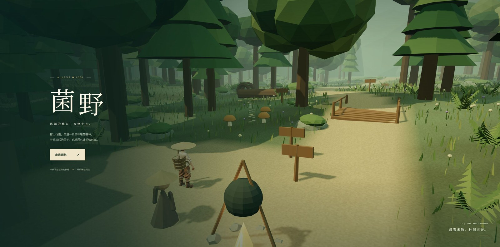

# 菌野 · 美味菌子在哪里

根据《采菌子内容设计》制作的第三人称 3D 山野探索游戏。使用原创程序化森林、用户提供的主角模型，以及暖光、草木、薄雾和清晰的交互反馈，呈现受塞尔达式探索氛围启发的山野旅程。



## 运行

游戏通过本地服务在浏览器中运行，支持 Windows 和 macOS。请使用支持 WebGL 2 的现代浏览器，并开启硬件加速。

### 从 GitHub 克隆运行

仓库包含源码和全部必要游戏素材，不包含 Node.js、依赖目录或构建成品。先安装 [Node.js 22.12 或更新版本](https://nodejs.org/en/download)，再执行：

```sh
git clone https://github.com/QiGS/mushroom.git
cd mushroom
npm start
```

首次启动会自动安装依赖、构建游戏并打开浏览器，需要联网。以后直接 `npm start`。Windows 也可双击 `启动游戏.cmd`，macOS 可双击 `启动游戏.command`。如果从 GitHub 下载 ZIP 后 `.command` 丢失执行权限，可在该目录的终端执行 `bash 启动游戏.command`。

启动器自动选择可用的本地端口。运行时保留终端窗口，按 Ctrl+C 停止。更新源码后执行 `npm ci && npm run build`，然后重新启动，避免继续使用旧的构建。

### 便携压缩包

完整解压后，在顶层目录启动，不要进入 `source` 目录或直接在压缩软件里运行：

| 压缩包 | 启动入口 | 运行环境 |
| --- | --- | --- |
| `菌野-Windows即玩版.zip` | `Mushroom-Windows/启动游戏.cmd` | 内置 Windows x64 Node.js |
| `菌野-macOS即玩版.zip` | `Mushroom-macOS/启动游戏.command` | 内置 Apple 芯片与 Intel 两种 Node.js，自动选择 |

便携包包含构建成品，无需另装 Node.js 或 npm 依赖。macOS 包面向 macOS 11 及更新版本。游戏进度保存在当前浏览器的当前地址中，继续游玩请使用同一浏览器和端口。便携包保存在制作电脑本地，不随 `git clone` 下载；仓库包含复现打包脚本。

### 开发与构建

```sh
npm ci
npm run dev
```

打开终端显示的 `http://127.0.0.1:5173/`。

```sh
npm test          # 游戏规则与场景验收
npm run build    # 生成 dist
npm run preview  # 预览生产构建
```

开发环境还安装 Python 3 后，可以执行 `python scripts/package-macos.py` 生成 macOS 便携包（首次下载两种官方运行环境并校验 SHA256），或执行 `python scripts/package-windows.py --node "官方 Node.js 目录/node.exe"` 生成 Windows 便携包。打包前先运行 `npm ci` 和 `npm run build`。

`dist` 是可独立托管的静态网站，资源路径支持部署在 `/mushroom/` 等子目录。仓库内提供 GitHub Actions 构建检查和手动触发的 Pages 部署流程；首次部署需在仓库 Settings → Pages 选择 GitHub Actions。

## 三段旅程

| 章节 | 目标 | 主要互动 |
| --- | --- | --- |
| 雨后初采 | 山野菌 12 朵、发现至少一处菌窝，返回村口 | 奶奶线索、零散菌子、拨开落叶、树洞宝箱、草丛预警、寻菌指南针 |
| 竹林夺菌 | 竹香菌 12 朵、金伞菌 8 朵，击败青影后返村 | 竹杖攻击、闪避、投石诱导、竹筒声响、树根碰撞眩晕、两段突进、尾扫、护身斗笠 |
| 雾山迷踪 | 云团菌 10 朵、月牙菌 6 朵，解开石门后返村 | 大叔和山獾支线、红布路标、三声回响、月牙潭踏石、抱抱树守卫、雾尾鼠与听风铃、三石牌谜题 |

通过加料、盖盖、开锅的交互，将收获做成山野菌子汤、竹香焖菌饭和云雾菌煲。菜谱永久解锁，并在村庄餐桌上出现。第三关完成后三关主线结束，可重游已有章节收集图鉴和成就。设计稿结尾的采菌赛作为未来关卡伏笔，本版本没有虚构第四关。

晴天、雨后、薄雾会改变视距和额外菌窝。线索对应实际生成位置，任务必要食材总量稳定。首次关卡期限分别为 10、13、16 分钟，菜单和后台页面暂停计时；天黑后向导接回村口并保留全部收获，仅取消按时归来的额外奖励。

## 操作

Windows 版进入游戏后会捕获鼠标，直接移动鼠标即可连续环视，不必按住按键。左键挥杖，滚轮调整距离，Esc 暂停并释放鼠标。背篓、地图、对话和拍照会释放鼠标；关闭面板后点击游戏画面，或在设置中点击“继续游戏 · 捕获鼠标”恢复。浏览器未允许捕获时仍可按住拖动环视，设置中的灵敏度同时影响水平和垂直方向。

Windows 人物使用为原始模型新增的 16 关节程序化骨架：左右脚交替抬脚、屈膝和落地，手臂反向摆动，转弯倾斜，起停加减速，跳跃与落地混合，以及采集、闪避和挥杖姿态。帽子、背篓和竹杖跟随对应关节。上述新行为只在 Windows 浏览器启用，macOS 保留原来的控制和动画。

| 输入 | 动作 |
| --- | --- |
| WASD / 触屏摇杆 | 相对镜头移动 |
| Windows 移动鼠标 / 其他平台拖动 / 方向键 | 环视 |
| 滚轮 | 镜头距离 |
| Shift / Space | 奔跑 / 跳跃 |
| E | 交谈、采集、拨开落叶、开箱、记录路牌；巨型云团菌需按住 |
| F | 观察菌子、拨开危险草丛 |
| J / Q / R | 竹杖攻击 / 闪避 / 向前投石诱导 |
| H | 使用回复果 |
| C / X / V | 寻菌指南针 / 疾风草鞋 / 听风铃 |
| B / G / M / L | 背篓 / 图鉴 / 地图 / 手记 |
| P / Esc | 拍照模式 / 设置或返回 |

触屏设备有移动、跳跃、交互、攻击、闪避、投石、观察按钮。其余道具可在背篓中操作。地图可点击设置方向标记，不自动移动，也不直接标出尚未发现的菌窝。

## 进度与规则

- 当前浏览器自动保存位置、食材、探索、永久奖励和设置。存储失败时明确提示；不依赖账户或服务器。
- 基础背篓容量 24，可用 80 竹叶币扩为 36。巨型云团菌不占食材容量。
- 出售只处理超出当前任务要求的食材，避免卖掉必需品导致无法交付。
- 受击有短暂无敌时间；体力耗尽回到休息点，保留菌子与已完成探索，当前守卫恢复。
- 开箱、采集和首次通关奖励具有去重保护。新旅程重新生成采集物，长期图鉴和菜谱保留。
- 菌种、动物行为和道具均属架空游戏设定，不是现实采食指南。

## 素材与实现

- `public/assets/traveler.glb` 来自项目所有者提供的 `主角_3d.glb`。原始约 195 万三角面 / 65 MB，经简化和贴图缩放后为 68,411 三角面 / 2.32 MB。素材权利归原权利方。
- 森林、竹林、村庄、道具、NPC、菌子、水面、植物与粒子由 Three.js 程序化构建。没有使用任天堂模型、音乐或游戏资源。
- 主角源模型没有骨骼动画。Windows 运行时新增关节权重与程序化步态，其他平台保留原有形变动画；动作没有使用动作捕捉素材。
- 环境音、提示音和轻柔旋律由 Web Audio 合成。字体可从 Google Fonts 加载，离线时使用系统衬线字体。
- 原始 GLB、参考图片、导出的 DOCX 和工作缓存不提交到仓库。可运行版本所需资源全部包含在 `public` 中。
- 如需重新简化模型，把原始 `主角_3d.glb` 放在项目根目录，安装 Python 与 Pillow，然后执行 `npm run optimize`。

## 项目结构

```text
src/state.js    任务、奖励、存档验证与确定性菌窝生成
src/world.js    森林场景、植被实例、地形、道具与角色
src/main.js     移动、碰撞、相机、战斗、交互与游戏循环
src/ui.js       HUD、背篓、图鉴、地图、料理、设置与对话
src/audio.js    Web Audio 音景和交互反馈
src/qa.js       仅开发模式的场景验收工具，不进入生产包
tests/         规则、存档、可通关性与场景有效性测试
```

开发模式可访问 `/?qa` 使用验收面板。它使用独立的测试存档，不影响正常游戏记录；正式构建不包含测试面板或解锁入口。

目前提供完整三关可玩闭环。场景采用风格化低多边形表现，关卡共享基础地形并按章节布置竹林、雾山和谜题；设计稿中的部分逐镜头演出、草丛青蛙笑点及服装定制界面未制作成独立系统。
