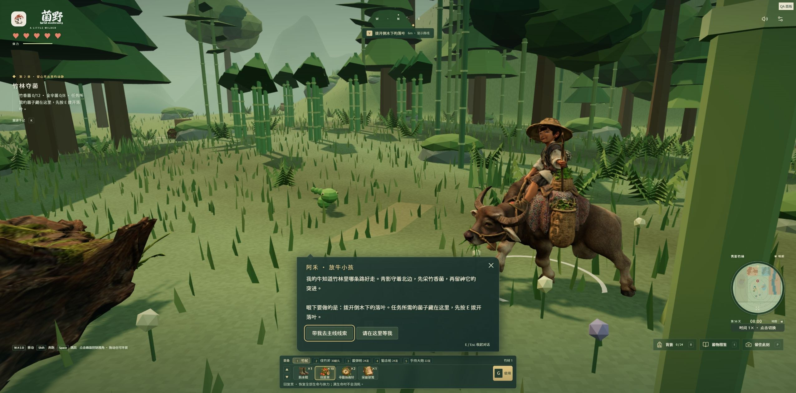
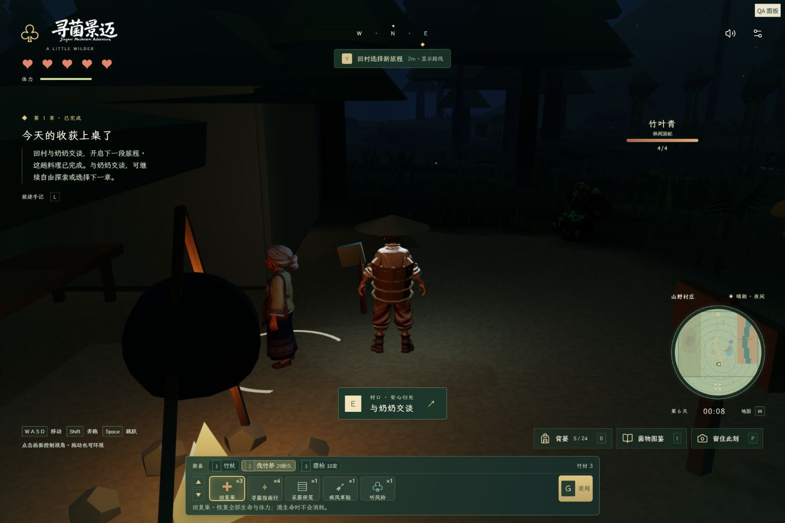
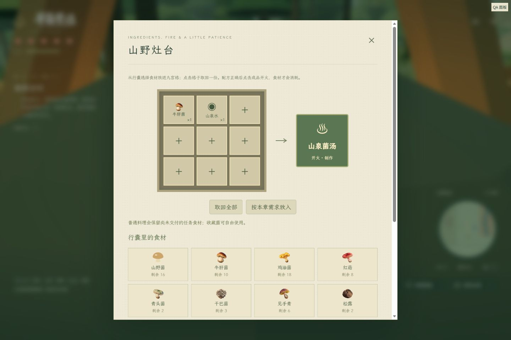
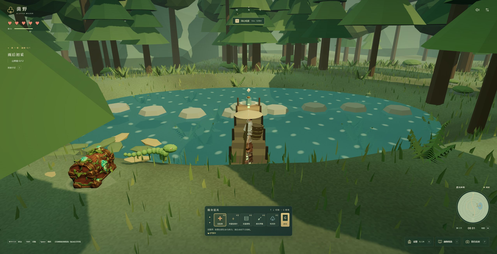
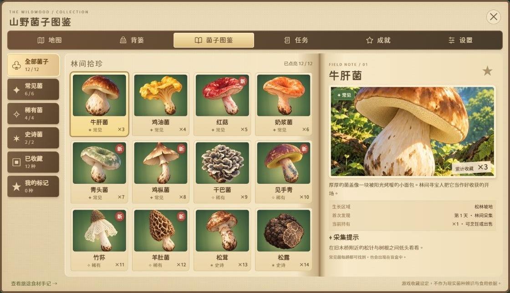
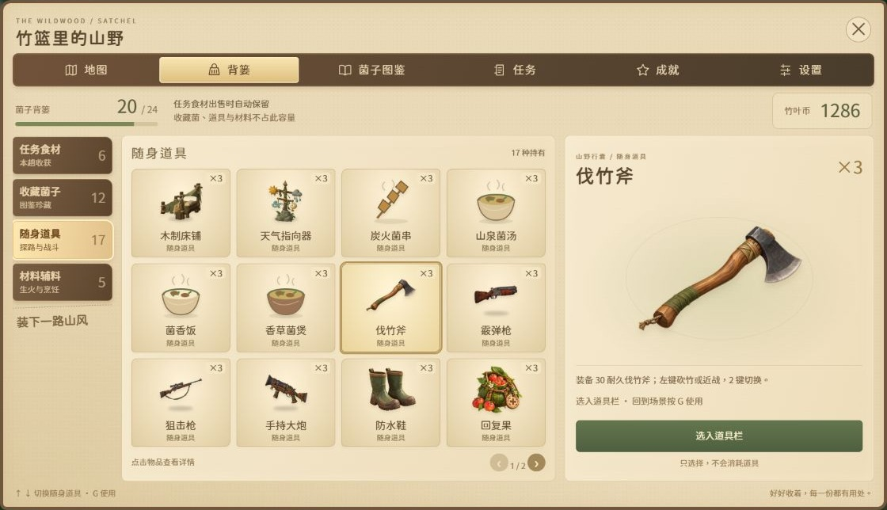
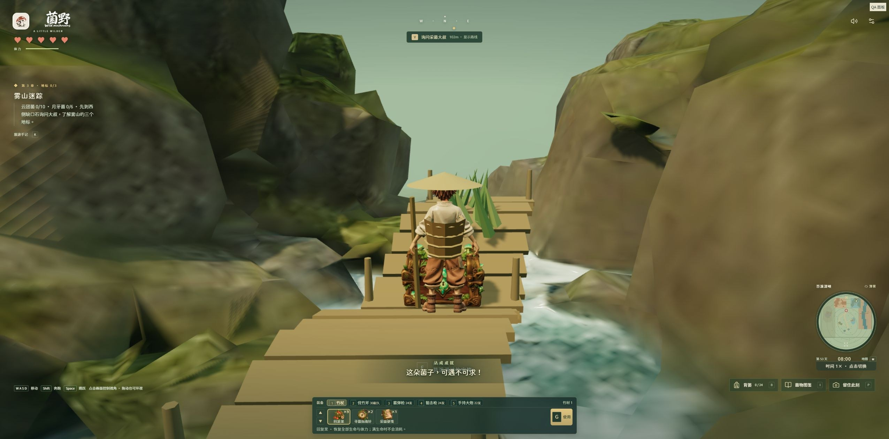
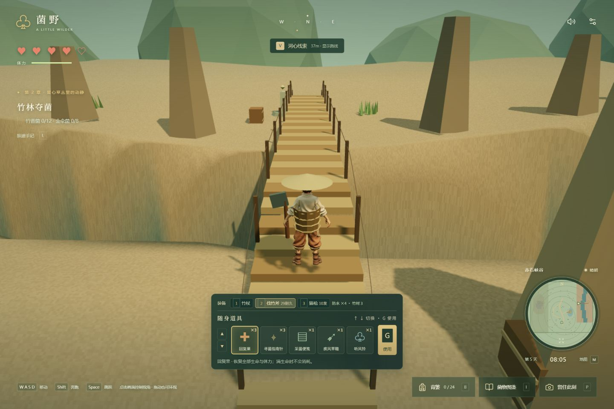
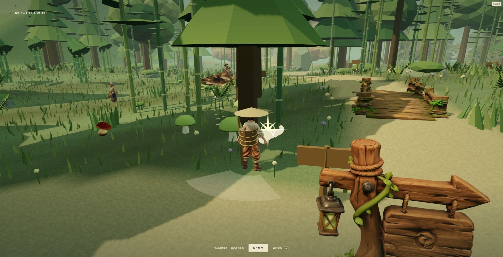

# 菌野 · 美味菌子在哪里

根据《采菌子内容设计》制作的第三人称 3D 山野探索游戏。使用程序化地形与用户提供的草木、岩石和主角模型，以及暖光、草木、薄雾和清晰的交互反馈，呈现受塞尔达式探索氛围启发的山野旅程。


## 运行

游戏通过本地服务在浏览器中运行，支持 Windows 和 macOS。请使用支持 WebGL 2 的现代浏览器，并开启硬件加速。

### 从 GitHub 克隆运行

仓库包含源码和全部必要游戏素材，不包含 Node.js、依赖目录或构建成品。先安装 [Node.js 22.12 或更新版本](https://nodejs.org/en/download)，再执行：

```sh
git clone https://github.com/QiGS/mushroom.git
cd mushroom
npm start
```

首次启动会自动安装依赖、构建游戏并打开浏览器，需要联网。以后直接 `npm start`。Windows 也可双击 `启动游戏.cmd`，macOS 可双击 `启动游戏.command`。如果从 GitHub 下载 ZIP 后 `.command` 丢失执行权限，可在该目录的终端执行 `bash 启动游戏.command`。

启动器自动选择可用的本地端口。运行时保留终端窗口，按 Ctrl+C 停止。更新源码后执行 `npm ci && npm run build`，然后重新启动，避免继续使用旧的构建。

### 便携压缩包

完整解压后，在顶层目录启动，不要进入 `source` 目录或直接在压缩软件里运行：

| 压缩包 | 启动入口 | 运行环境 |
| --- | --- | --- |
| `菌野-Windows即玩版.zip` | `Mushroom-Windows/启动游戏.cmd` | 内置 Windows x64 Node.js |
| `菌野-macOS即玩版.zip` | `Mushroom-macOS/启动游戏.command` | 内置 Apple 芯片与 Intel 两种 Node.js，自动选择 |

便携包包含构建成品，无需另装 Node.js 或 npm 依赖。macOS 包面向 macOS 11 及更新版本。游戏进度保存在当前浏览器的当前地址中，继续游玩请使用同一浏览器和端口。便携包保存在制作电脑本地，不随 `git clone` 下载；仓库包含复现打包脚本。

Mac 旧版已能正常启动时，可先关闭旧游戏页与启动窗口，替换新包里的 `dist` 文件夹及 `scripts/serve-game.cjs`（音乐播放支持），保留原有启动脚本和 `runtime`。首次使用完整便携包时仍可能出现 Apple 无法验证启动脚本或 `node` 的提示，本包尚未经过 Apple 公证；处理步骤见包内“先看这里.txt”及 [Apple 官方说明](https://support.apple.com/zh-cn/102445)。

### 开发与构建

```sh
npm ci
npm run dev
```

打开终端显示的 `http://127.0.0.1:5173/`。

```sh
npm test          # 游戏规则与场景验收
npm run build    # 生成 dist
npm run preview  # 预览生产构建
```

开发环境还安装 Python 3 后，可以执行 `python scripts/package-macos.py` 生成 macOS 便携包（首次下载两种官方运行环境并校验 SHA256），或执行 `python scripts/package-windows.py --node "官方 Node.js 目录/node.exe"` 生成 Windows 便携包。打包前先运行 `npm ci` 和 `npm run build`。

`dist` 是可独立托管的静态网站，资源路径支持部署在 `/mushroom/` 等子目录。仓库内提供 GitHub Actions 构建检查和手动触发的 Pages 部署流程；首次部署需在仓库 Settings → Pages 选择 GitHub Actions。

## 人物对白与战斗反馈

- 奶奶、大叔和每章向导使用底部纸质对白框、角色立绘与姓名牌。文字逐字出现，`E` 补全当前句，再按 `E` 继续；末页出现任务选项，`Esc` 离开。对话期间暂停战斗，森林保持可见。
- 竹杖、斧子和枪械命中会显示伤害数字、亮闪与掉血残影。普通怪物会被击退并短暂硬直，正在蓄力或冲刺的攻击会被打断；首领保留阶段与弱点机制，只产生较小退步。
- 玩家、游蛇的头身尾、蚁群与地面首领有实体碰撞。冲撞在接触玩家后收招，只结算一次命中；走路、闪避和受击后退都检查碰撞。近战可命中蛇尾，不再只检查头部中心。

## 五段旅程

| 章节 | 目标 | 主要互动 |
| --- | --- | --- |
| 雨后初采 | 山野菌 12 朵、发现至少一处菌窝，返回村口 | 奶奶线索、零散菌子、拨开落叶、树洞宝箱、草丛预警、寻菌指南针 |
| 竹林夺菌 | 竹香菌 12 朵、金伞菌 8 朵，击败青影后返村 | 竹杖攻击、闪避、投石诱导、竹筒声响、树根碰撞眩晕、两段突进、尾扫、护身斗笠 |
| 雾山迷踪 | 云团菌 10 朵、月牙菌 6 朵，解开石门、击退毒蚁母巢后返村 | 大叔和山獾支线、红布路标、三声回响、月牙潭踏石、抱抱树守卫、雾尾鼠与听风铃、三石牌谜题、毒蚁与蚁群战 |
| 花雾逐蝶 | 月牙菌 8 朵、金伞菌 6 朵，击退毒蝶女王 | 狙击开镜、空中首领、毒鳞与悬停弱点、花雾山径奶奶 |
| 赤岩终宴 | 云团菌 10 朵、金伞菌 8 朵，击退毒蝎王 | 大炮爆炸、硬甲反击、冲撞岩石、潜地尾针、赤岩驿亭交付 |

完成采集与探索要求后，回村向奶奶交付食材。奶奶只保留场景内的提示对话和交付；购买、出售、扩容竹篮都在大叔的山货铺，选择新章节移到公告牌。也可以在村口灶台用九宫格选择、叠放和取回食材，配方匹配后点击成品开火。按本章需求放料可将收获做成山野菌子汤、竹香焖菌饭、云雾菌煲、花雾清菌汤和峡谷丰收煲。菜谱永久解锁，并在村庄餐桌上出现。完成前三关后继续前往花雾高地与赤岩峡谷，击退空中的毒蝶女王和毒蝎王。第五关交付后完成五道菌宴，也可重游已有章节收集图鉴和成就。

晴天、雨后、薄雾会改变视距和额外菌窝。线索对应实际生成位置；雨后的菌子更多，晴天减少，必要任务食材仍然足够。五章白昼时长分别为 10、13、16、18、20 分钟，菜单和后台页面暂停计时；入夜后实际降低日光与环境光，月光、篝火、屋内灯光和随身照明仍可辨路。每个夜晚额外出现 4 条竹叶青、1 条霜叶蛇和 1 条岩纹蛇，天亮后退去；夜晚持续 4 分钟，随后进入新的一天。可以继续夜探，晚归不再强制送回村庄，仅失去按时奖励。

## 本章引路人

五章都安排了线索附近的引路人，使用 `npc/` 中提供的采花少女、放牛小孩与采菌大叔模型：第一、四章是阿花，第二章是骑牛的阿禾，第三、五章是阿山叔。

靠近按 **E**，选择“带我去主线线索”。向导会依据当前进度带到下一处任务地点，走远超过 8 米时停下来等你；可以交谈让他原地等候。抵达后向导留在线索旁边，让出交互位置；完成这一步再交谈，可以继续下一段。遇到首领时带到入口，采集、解谜与战斗仍由玩家完成。按 **M → 寻找引路人** 可让罗盘追踪本章向导，地图用蓝绿色人物标记显示；**V** 仍只引导当前主线。重新载入或切章时，向导回到本章初始位置。



## 山野日常：睡觉、天气与燃料

地图下面的时间按钮循环 **1× → 2× → 4× → 8× → 16× → 32× → 64×**，只加速昼夜、天气和篝火燃料，移动、战斗和水中扣血保持正常速度。菜单、对话和切到后台时暂停游戏时间。

- **床铺 60 币**：完成第一章、解锁小屋后向大叔购买。↑↓ 选中后按 G 安置，入夜靠近床按 E，选择“睡到天亮”。次日恢复生命体力，消耗跳过时段的燃料；设施永久保留。
- **篝火两天燃料**：开局满燃料，随游戏时间燃烧；熄灭时火焰与火光消失，无法烹饪。靠近火塘按 E 添竹材，每份续半天，最多储存两天。斧子砍竹获得竹材，竹子次日重新长出。
- **天气指向器 45 币**：购买后按 G 安置在公告牌旁，靠近按 E 看明天天气。预报在读档后保持一致，与自然换日或睡觉后的天气相符。
- **清晨刷新**：每天清晨自动生成新菌子，清理旧野生菌追踪线索、刷新竹子与小屋补给。雨后更多，晴天更少。背包、图鉴累计发现、任务进度、货币和已开宝箱均保留；宝箱只在主动开启新旅程时刷新。
- **采菌遇蛇**：采食材或收藏菌时偶尔惊动竹叶青；雨后概率高于晴天。出现时有文字与嘶声预警，短暂停顿后才开始行动，单日数量有限。

新增桥、岩石、路边公告牌、石碑、篝火、床与天气指向器 GLB；店主使用大叔模型。树冠靠近相机与角色视线时渐隐，墙壁与家具约束室内镜头，过近时隐藏角色避免看到模型内部。背景音乐使用提供的 `bgm.MP3`，配合自然鸟鸣流水，可在右上角关闭声音。

## 林间宝箱与菌子收藏

每趟山林有 8 只分散的探索宝箱，原有剧情宝箱还附送 1 份盲盒。靠近按 **E** 或左键直接开箱，获得一种随机菌子与随机数量。奖励一件一件在场景中弹出，**每按一次 E 切换到下一件，最后一件再按 E 收好**；不再自动播放。新菌种会记入图鉴，走远也会自动收好。重复菌子累加到实际库存，可以烹饪或出售，图鉴的累计发现与首次记录永久保留；收藏菌不占任务食材背篓。

| 品质 | 菌种 | 盲盒基础概率 | 每盒数量 |
| --- | --- | --- | --- |
| 常见 | 牛肝菌、鸡油菌、红菇、奶浆菌、青头菌、鸡枞菌 | 72% | 2–6 朵 |
| 稀有 | 干巴菌、见手青、竹荪、羊肚菌 | 24% | 1–3 朵 |
| 史诗 | 松茸、松露 | 4% | 1–2 朵 |

连续 7 盒没有稀有或史诗，第 8 盒至少稀有。保底次数跨存档、跨旅程保留。宝箱只由探索获得；同一趟不能重复领取，刷新页面也不会重抽结果。

按 **I** 打开羊皮纸风格的收藏图鉴：分类、翻页、未发现剪影、累计数量、首次发现记录和星标关注均可交互。集齐 3 / 6 / 12 种时，自动获得 20 / 50 / 100 竹叶币成就奖励。原有任务食材资料保留在图鉴底部的“旅途食材手记”。

每天雨后会出现 6 种常见、2 种稀有和 1 种史诗菌的可采集实体；晴天常见菌降为 3 种、薄雾为 5 种。稀有种类轮换，史诗种类隔天交替。开箱便笺只指向本趟尚未采走的稀有或史诗菌，按 **M** 在地图查看搜索圈，并点击线索让指南针追踪。采走后线索消失，重游清空旧线索并刷新宝箱；收藏、星标和成就继续保留。旧版存档会自动补上收藏数据。

每趟有 **8 只分区探索宝箱**，分布在西麓、北林、山巅、峡谷南口、东岭、苔溪深峡、赤岩谷底和花雾东坡；另保留各章剧情宝箱。所有宝箱离出生点至少 25 米，彼此至少 24 米，出生地附近不再堆放。山顶与谷底均有可步行往返的路线。宝箱使用关闭与开启两套 GLB，靠近按 **E** 或左键直接打开；菌子、道具与线索按 E 逐件切换，没有背景框，最后再按 E 收好。奖励在开箱时一次性存档，提前收起不会丢失或重复领取。每只探索宝箱还会发放一份随身道具。图鉴使用「菌子游戏资产」中的 12 张菌子卡片和 12 张详情插画。



## 自由烹饪与大叔的山货铺

靠近有燃料的火塘按 E，再选择“在火上烹饪”。点击持有的食材放入九宫格，同类可叠加；点击格子取回一份，“取回全部”清空选择。配方不匹配时无法开火，也不会损失食材。以下普通配方不限菌种组合，成品进入道具栏，按 G 食用。

| 料理 | 配方 | 效果 |
| --- | --- | --- |
| 炭火菌串 | 菌子 ×3 | 恢复 2 点生命 |
| 山泉菌汤 | 菌子 ×1 + 山泉水 ×1 | 恢复 3 点生命 |
| 菌香饭 | 菌子 ×2 + 稻米 ×1 + 盐 ×1 | 恢复生命，8 秒加速 |
| 香草菌煲 | 菌子 ×2 + 山野香草 ×1 | 恢复生命，获得一次护身 |

普通料理自动保留尚未交付的本章必需食材，可自由使用收藏菌和多余任务菌。完成探索后，“按本章需求放入”填入本章料理配方，点击成品完成章节结算。大叔处可按份卖出持有菌子，买入当前任务缺少的菌子、调料、听风铃、便笺、草鞋和装备；图鉴同时显示累计发现与当前持有。



## 河心线索与随身道具

月牙潭中央新增石台、漂流瓶便笺与通往西岸的木浮桥。沿桥抵达后按 **E**，每趟可获得采菌便笺和寻菌指南针各 1 个。按 **M** 查看河心标记、稀有菌搜索圈、方向罗盘与当前目标；点击线索可以切换追踪对象。按 **V** 开关主线贴地虚线，引导路线避开树木、深水和关闭的石门；地图同步显示主线路线。收藏线索和自选标记通过罗盘追踪，不覆盖 V 的主线目标。任务提示与手记向导说明下一步剧情；抵达目标后虚线自动关闭，已获得的收藏线索仍保留。

所有获得的道具和普通料理统一放入底部扁平道具栏，同类叠加。**↑ / ↓ 切换，G 使用**，也可点击道具和使用按钮。成功使用后扣除 1 个，数量归零的格子消失；当前没有有效用途时不会消耗。

| 道具 | 使用效果 |
| --- | --- |
| 回复果 | 恢复全部生命与体力 |
| 寻菌指南针 | 揭示本趟真实的稀有菌线索；无线索时标记未开的宝箱 |
| 采菌便笺 | 揭示一条稀有或史诗菌线索，优先史诗 |
| 疾风草鞋 | 获得 8 秒加速 |
| 护身斗笠 | 抵挡下一次伤害或草丛惊吓 |
| 听风铃 | 标记最近的已发现地标；没有地标时指向村庄 |

道具、已启用的护身效果和收藏会保存；未用完的道具随旅程保留。旧版永久装备会按现有数量迁移为消耗道具，已经使用完的道具不会在刷新或重游后重新出现。



### 统一山野手记

图鉴、背篓、地图、任务、成就和设置共用暖纸页、木色导航及手写标题。面板随窗口高度调整；桌面窗口中 12 种收藏菌同屏展示，点击卡片查看插画、持有数量、发现记录与采集提示，无需翻页或向下滚动图鉴。

背篓按任务食材、收藏菌子、随身道具、材料辅料分类，使用插画卡片与右侧详情。任务食材及四种料理补充了不同轮廓的图标。随身道具超过 12 种时分页，查看或选入道具栏不会消耗，回到场景按 G 才使用；容量、数量、任务需求与竹叶币分别清晰显示。成就页同时展示收藏里程碑和已获得的旅途称号，设置页将偏好与操作手册并排排列。




## 山岭、峡谷与装备

可探索范围扩展到 184 × 150 米，约为原来的 3 倍。西侧风铃山岭有可步行登顶的山路、断崖和观景碑；东侧赤石峡谷有约 20 米落差、谷底河流和吊桥。按 **M** 选择山巅、观景台、峡谷或山货铺，由罗盘指示方向；**V** 只显示当前主线的安全路线。首次记录探索碑可获得竹叶币与道具。

苔溪深峡由 28 × 30 米扩为 36 × 36 米，赤岩峡谷由 38 × 32 米扩为 46 × 38 米，模型和可行走地形同步扩大。苔溪沿溪铺设连续木栈道，河心浮桥、石台、踏石和峡谷吊桥加宽。小台阶更易跨过，已有树根或家具边缘重叠时可以向外脱离，高墙仍会阻挡行走。深峡、谷底、东坡与西岭增加 15 处高草、木箱和陶罐，以及两处探索碑奖励；新增宝箱仍保持区域间距，村口不堆放。



村庄餐桌、炉灶、房屋墙壁和家具会阻挡移动，包括冲刺和闪避。完成第一章返村料理后，山间小屋的门打开，可以直接走入、查看内景并歇脚恢复生命与体力。房内亮起的回复果、便笺和斗笠可按 E 收取，每处经过 3 分钟实际游玩后刷新；暂停菜单与后台不计时，刷新页面不会提前领取。

**左键** 使用当前武器。竹叶青、首领青影、山岭霜叶蛇和峡谷岩纹蛇会在头顶显示名称、种类和实时血量。击打高草、陶罐或木箱能显露物品，再按 E 或左键拾取；韧竹需要伐竹斧，竹材可回山货铺出售，每份 4 竹叶币。可破坏物和掉落每趟只结算一次，新旅程刷新。

| 村口山货铺装备 | 价格 | 装备后效果 |
| --- | --- | --- |
| 伐竹斧 | 40 竹叶币 | 30 次有效命中耐久，伤害 2；砍竹、破箱 |
| 霰弹枪（第三章） | 100 竹叶币 | 12 发，伤害 8，18 米锥形群体攻击，4 发弹匣 |
| 狙击枪（第四章） | 180 竹叶币 | 12 发，伤害 32，64 米射程，3 发弹匣；右键 / Z 开镜 |
| 手持大炮（第五章） | 280 竹叶币 | 8 发，伤害 128，38 米射程，5.5 米爆炸范围，1 发弹匣 |
| 防水鞋 | 30 竹叶币 | 抵减 5 次水中伤害，每次从 2 减为 1 |

购买后先进入道具栏，**↑↓ 选中，G 装备**；道具从栏内移除，耐久、弹药与防水次数显示在装备条。**1 / 2 / 3 / 4 / 5** 切换竹杖、斧子、霰弹枪、狙击枪与手持大炮。装备耗尽自动换回竹杖，可重新购买；枪械可用备用道具包补弹至携带上限；满弹药时不会消耗道具。商店也出售回复果、指南针和斗笠，交易只使用游戏内竹叶币。

掉入深水会留在水面，可用 WASD 游回岸边；每 3 秒损失 2 点生命，穿戴防水鞋后每次损失 1 点并消耗一次防水次数，上岸即停止水中计时与伤害。从超过 3.3 米的高度落地会根据落差扣除 1–4 点生命，普通跳跃不扣血。生命耗尽后回到休息点，保留收获。靠近地图边缘时屏幕逐渐泛红，并提示“这里的区域以后再来探索吧。”。



## 镜头与战斗反馈

镜头遇到树干、墙壁或山体时沿当前观察方向收近，离开遮挡后平滑恢复到滚轮设定的距离；进入小屋不再硬切一个固定视距。矮石头使用实际高度，圆形树干使用圆形边界，地形也不会把镜头突然抬到山坡上。正常 WASD 行走保持玩家选定的水平视角；狭窄位置仍会适当收近，避免看进墙里。

竹叶青的头、身体和尾巴都参与碰撞检查，巡游、转身、冲刺和受击后退会在障碍前停住。蚁群与地面首领使用对应身体大小的碰撞范围；生成、换日与重生检查完整落脚区域。竹叶青撞到障碍仍会眩晕，可以趁机反击。

竹杖挥出时有短促破风声，命中后叠加敲击声、暖金星芒、怪物亮闪和短暂停顿，普通怪物会小幅后退，后退也受碰撞约束。枪械命中使用同一套反馈。主角受伤时有短暂身体后仰、暖红亮闪和屏幕边缘提示，受击声与命中声分开；这些反馈不添加镜头摇晃。声音开关同时控制音乐与音效。



## 操作

Windows 和 macOS 版进入游戏后会捕获鼠标，直接移动鼠标即可连续环视，不必按住按键。左键攻击或与面前物品交互，滚轮调整距离，Esc 暂停并释放鼠标。背篓、地图、对话和拍照会释放鼠标；关闭面板后点击游戏画面，或在设置中点击“继续游戏 · 捕获鼠标”恢复。浏览器未允许捕获时仍可按住拖动环视，设置中的灵敏度同时影响水平和垂直方向。

Windows 和 macOS 人物使用为原始模型新增的 16 关节程序化骨架：左右脚交替抬脚、屈膝和落地，手臂反向摆动，转弯倾斜，起停加减速，跳跃与落地混合，以及采集、闪避和挥杖姿态。帽子、背篓和竹杖跟随对应关节。两种桌面平台使用相同的动作与视角逻辑，触屏设备保留原有操作。

| 输入 | 动作 |
| --- | --- |
| WASD / 触屏摇杆 | 相对镜头移动 |
| 移动鼠标 / 触屏拖动；← → 水平、PgUp / PgDn 垂直 | 环视 |
| 滚轮 | 镜头距离 |
| Shift / Space | 奔跑 / 跳跃 |
| E | 交谈、采集、开箱、拾取补给；再次按 E 收起发现提示；巨型云团菌需按住 |
| F | 观察菌子、拨开危险草丛 |
| 左键 | 优先攻击面前怪物、击打可破坏物；否则与附近物品交互 |
| J / Q / R | 当前武器攻击 / 闪避 / 枪械装填（近战武器为投石） |
| 1 / 2 / 3 / 4 / 5 | 竹杖 / 斧子 / 霰弹枪 / 狙击枪 / 手持大炮 |
| Z / 鼠标右键 | 狙击开镜与收镜；开镜滚轮调整 2–6 倍 |
| ↑ / ↓ | 切换当前道具 |
| G | 使用当前道具，或装备斧子、枪械、防水鞋；枪械道具包可补弹 |
| V | 开关虚线引导 |
| B / I / M / K | 背篓 / 图鉴 / 地图 / 手记 |
| L | 进入任意章节，或直达第二至五关 Boss 战 |
| P / Esc | 拍照模式 / 设置或返回 |

触屏设备有移动、跳跃、交互、攻击、闪避、投石、观察按钮。道具栏支持点击选择、切换和使用。地图可点击设置方向标记，不自动移动，也不直接标出尚未发现的菌窝。

## 进度与规则

- 当前浏览器自动保存位置、食材、探索、永久奖励和设置。存储失败时明确提示；不依赖账户或服务器。
- 基础背篓容量 24，可用 80 竹叶币扩为 36。巨型云团菌不占食材容量。
- 大叔的山货铺按菌种出售实际库存；任务食材仅出售超额部分，收藏菌可全部出售，历史图鉴不丢失。购买食材、调料、任务道具和装备都使用竹叶币。
- 受击有短暂无敌时间；体力耗尽回到休息点，保留菌子与已完成探索，当前守卫恢复。
- 开箱、采集和首次通关奖励具有去重保护。新旅程重新生成采集物，长期图鉴和菜谱保留。
- 菌种、动物行为和道具均属架空游戏设定，不是现实采食指南。

## 素材与实现

- 本章引路人来自项目所有者提供的 `npc/` 三个 GLB，原始约 207 MB；每个运行模型约 18,000 三角面，合计约 3.5 MB。原始模型仅保留本地，优化结果和统计位于 `public/assets/villagers/`；有原始文件时可用 `node scripts/prepare-guides.mjs` 复现。

- `public/assets/traveler.glb` 来自项目所有者提供的 `主角_3d.glb`。原始约 195 万三角面 / 65 MB，经简化和贴图缩放后为 68,411 三角面 / 2.32 MB。素材权利归原权利方。
- 12 种收藏菌与竹篮来自项目所有者在 `mushroom/` 中提供的 GLB。原始素材约 850 MB，这批运行模型共约 6 MB。新宝箱的两套 GLB 各简化至约 18,000 三角面，共约 2.5 MB；图鉴插画来自「菌子游戏资产」，24 张 WebP 共约 3.2 MB。优化统计见 `public/assets/collection/manifest.json`，素材权利归原权利方。
- 奶奶与采菌大叔使用项目所有者新提供的 GLB，分别简化至约 30,000 三角面 / 1.38 MB。树木、竹林、可砍竹子和散布岩石使用项目所有者提供的 GLB；地形、村庄部分结构、任务食材、水面、草与粒子由 Three.js 程序化构建。没有使用任天堂模型、音乐或游戏资源。
- 六种手绘道具图标来自 `道具二维/`，公告牌、奶奶对话框和 Logo 来自 `Jingmai_Mountains/`，经尺寸优化转为 WebP。六种山体 GLB 以 70 段实例组成近、中、远三层山景，按现有世界边界调整尺寸；山巅平台、峡谷岸线与通路由游戏地形提供。原始可选道具 GLB 不属于运行必需资产。
- 主角源模型没有骨骼动画。Windows / macOS 运行时新增关节权重与程序化步态，其他平台保留原有形变动画；动作没有使用动作捕捉素材。
- 背景音乐与自然环境音来自项目所有者提供的 bgm.MP3、自然鸟鸣流水.MP3；交互提示音由 Web Audio 合成。标题使用项目所有者在 new/ 提供的“菌野 Wild Mushrooms”手写字图，旧景迈字图保留用于资源兼容。场景界面、地图与提示使用 Jingmai Rounded Font Kit 指定的源泉圆体：套件未附字体二进制，现基于官方 [GenSen Rounded v2.100](https://github.com/ButTaiwan/gensen-font/releases/tag/v2.100) 制作离线 WOFF2 子集，改名为 Jingmai Rounded UI。保留 SIL OFL 1.1 许可证在 `public/assets/fonts/GenSenRounded-OFL.txt`，无需联网加载字体。旧 Wenkai 文件与许可证保留供已有版本资源兼容。
- 原始 GLB、参考图片、导出的 DOCX 和工作缓存不提交到仓库。可运行版本所需资源全部包含在 `public` 中。
- 如需重新简化模型，把原始 `主角_3d.glb` 放在项目根目录，安装 Python 与 Pillow，然后执行 `npm run optimize`。
- 重新处理收藏素材：将原始文件放入 `mushroom/`，安装 Python 的 Pillow、numpy，然后执行 `node scripts/optimize-collection.mjs`。图鉴插画放入 `菌子游戏资产/` 后执行 `python scripts/prepare-journal.py` 转为 WebP。新增道具使用 `node scripts/prepare-props.mjs`，从 `道具二维/` 压缩七个原始 GLB（面数与贴图优化），并准备家具图标和音频。日常运行无需这些原始文件或 Python。村民模型使用 `node scripts/prepare-villagers.mjs`；圆体字体使用 `python scripts/prepare-rounded-font.py`（需要 fontTools 与 brotli，以及官方 v2.100 的 `work/fonts/GenSenRounded2TC-R.otf`）；新山体及 UI 插画使用 `python scripts/prepare-scenery.py`，需要 Pillow 和用户提供的原始素材。以上脚本仅在重新制作素材时需要，克隆运行直接使用仓库内的优化结果。

## 项目结构

```text
src/state.js    任务、奖励、存档验证与确定性菌窝生成
src/world.js    森林场景、植被实例、地形、道具与角色
src/main.js     移动、碰撞、相机、战斗、交互与游戏循环
src/ui.js       HUD、背篓、图鉴、地图、料理、设置与对话
src/collection.js       收藏品、盲盒掉落、保底、线索、存档兼容
src/collection-world.js 收藏模型加载、探索宝箱与开盖状态
src/chest-model.js      原始宝箱两种状态的模型加载
src/tools.js            消耗道具、切换、效果与旧存档迁移
src/toolbelt-ui.js      随身道具栏
src/navigation.js      河心目标、地表高度与 A* 安全路线
src/route-guide.js     贴地虚线与目标环
src/terrain.js         实际高程、可行走表面、连续碰撞和跌落检测
src/exploration.js     山货铺、装备消耗、可破坏物和探索奖励
src/exploration-world.js 小屋内景、商店、掉落模型、山路与峡谷吊桥
src/combat.js          攻击范围、遮挡与怪物种类
src/adventure-ui.js    怪物血条、装备条和边界提醒
src/equipment-visual.js 手持斧子、三种枪械与动作挂接
src/collection-ui.js    图鉴、开盒揭晓、收藏成就
src/audio.js    本地 MP3 音乐、自然音景和 Web Audio 交互反馈
src/journey.js  昼夜、水中持续伤害、小屋补给刷新
src/cooking.js  自由配方、库存交易和料理消耗
src/journey-panels.js 九宫格烹饪和大叔交易界面
src/seasons.js  次日天气、自然生长、燃料、睡觉与采菌遇蛇
src/camera-collision.js 镜头体积碰撞与视线树冠渐隐
src/prop-model.js 新场景道具模型加载
src/scene-dialog.js 场景内提示、交付、篝火、床与天气对话
src/mission.js  当前任务的提示与目标
src/scene-notice.js 场景旁的发现卡片
src/villagers.js 新奶奶/大叔模型的异步加载
src/qa.js       仅开发模式的场景验收工具，不进入生产包
tests/         规则、存档、可通关性与场景有效性测试
```

开发模式可访问 `/?qa` 使用验收面板。它使用独立的测试存档，不影响正常游戏记录；正式构建不包含测试面板；L 为正式的章节旅行与首领战入口。

目前提供完整五关可玩闭环。场景采用风格化低多边形表现，关卡共享基础地形并按章节布置竹林、雾山和谜题；设计稿中的部分逐镜头演出、草丛青蛙笑点及服装定制界面未制作成独立系统。


## 峡谷与毒蚁母巢更新

- `V` 只引导当前主线，地图中的收藏线索仍可通过指南针追踪。寻路终点选择目标旁可交互的位置，修复第三关空心石与路牌附近没有路线的问题。
- `L` 打开山野驿路，可进入任意章节或直达青影、毒蚁母巢战；保留行囊、钱币与图鉴，不自动发放通关奖励。旅途手记改为 `K`。
- 第三关：询问大叔、敲响回声石、记录三个地标、解开石门、击退毒蚁母巢、采集菌子并交付。奶奶会在竹林歇脚处、雾山岔路、回声坡及石门旁出现，地图与主线提示同步显示位置。
- 毒蚁母巢 64 生命，分三阶段使用预警冲刺、范围扫击、延迟酸液与召唤蚁群；蚁群同时最多六只。撞击障碍后眩晕，反击伤害翻倍。后两章的野外敌人更多，夜晚还会出现额外巡游怪物。Boss 血条固定在屏幕上方。
- 枪械由相机准星决定命中目标，检查高低差、墙壁与地形；霰弹枪覆盖多个敌人，狙击枪选择最近的单个目标，大炮发射真实飞行炮弹并检查爆炸遮挡。`R` 装填分别耗时 1.6 / 2 / 2.6 秒；斧子与竹杖仍可近战，近战装备下 `R` 为投石。
- 开箱后按 E 逐件收好奖励，最后关闭时宝箱消失；已领奖励和消失状态会存档。新增场景文字旁白与七个采菌成就，包含“这块地有点东西。”“捅了菌子窝了！！”“采得漂亮”“采菌高手”“这朵菌子，可遇不可求！”“云南人看了都眼红”“好菌子，都藏在后面”。称号可在手记中查看。
- 苔溪深峡与赤岩峡谷使用 `道具二维/峡谷1.glb`、`峡谷2.glb`，模型同步烘焙 96×96 高度场供行走、跌落与寻路使用。`new/` 的枯木、两种岩石、毒蚂蚁、装备图标和食材图标替换对应旧素材；原文件不改动。
- 地图下方时间速度最高 64×，只改变昼夜、天气、生长和燃料。换日复用森林与收藏模型，保留进行中的首领战血量、阶段与装填状态，避免高速换日反复建场景或重置战斗。合并菌子/落叶绘制，远处敌人停止 AI，高分辨率按像素预算渲染并自动降采样，阴影分时刷新。
- 新资产准备：`node scripts/prepare-frontier.mjs`，随后 `node scripts/prepare-frontier-height.mjs`；需要原始资产以及现有 Python/Pillow/numpy 环境。日常运行使用仓库内的压缩成品，无需这些工具。


## 花雾与赤岩更新（第四、第五关）

- **第四关「花雾逐蝶」**：花雾山径找奶奶，去大叔铺子购买并用 G 装备狙击枪，按 V 前往空域。毒蝶巡游、发射毒鳞、投下酸液；仅狙击枪有效，悬停窗口伤害翻倍。击退后采齐月牙菌 ×8、金伞菌 ×6，向奶奶交付「花雾清菌汤」。
- **第五关「赤岩终宴」**：赤岩驿亭找奶奶，购入大炮。毒蝎使用冲撞、尾针、钳击与潜地，随剩余生命切换三个阶段；利用场地岩石制造反击窗口。击退后采齐云团菌 ×10、金伞菌 ×8，交付「峡谷丰收煲」。
- 武器按已解锁章节出现于商店。旧存档完成前三道菜后自动开放第四关；永久解锁、收藏、背包和弹匣都保留。`L` 可直接进入五章或四场首领战，不会赠送武器、金币或通关奖励。
- 地图新增四种首领徽记、实时位置、血量、推荐装备和打法。`M` 可切换全境 / 身边 2×、简化标记、罗盘追踪首领；击败标记变绿。`V` 继续只负责主线。

| 章节 | 首领 | 生命 | 对应枪械基础 / 弱点伤害 |
| --- | --- | ---: | ---: |
| 2 | 青影 | 16 | 近战反击 |
| 3 | 毒蚁母巢 | 64 | 霰弹枪 8 / 16 |
| 4 | 毒蝶女王 | 256 | 狙击枪 32 / 64 |
| 5 | 赤岩毒蝎王 | 1024 | 大炮 128 / 256 |

首领每章生命 ×4，匹配枪械每档伤害 ×4；命中普通状态约 8 发、全打弱点约 4 发，装填与躲避构成节奏。毒蝎硬甲减免普通武器伤害，炮弹可穿透硬甲；毒蝶对其它武器免疫。弹药总数包含弹匣，R 不会凭空增加弹药。

新增模型来自所有者提供的 `new/`：毒蝴蝶、毒蝎子、霰弹枪、狙击枪、手持炮。通过 `scripts/prepare-encounters.mjs` 简化为约 6,000–16,000 三角面和 1024 像素纹理；枪械模型按需加载。处理结果与来源见 `public/assets/props/encounter-manifest.json`。


## 本地林景资产与双手持枪（2026-11-01）

- `道具二维/树木2.glb`、`树木3.glb` 替换林间背景树；`竹林 3d.glb`、`竹子3d.glb` 用于第二章竹林及可砍竹子。`岩石.glb` 与 `new/岩石2.glb`、`岩石3.glb` 也用于各章散布岩石。
- 新增四个草木模型经面数与贴图优化，共约 3.35 MB；按空间分块实例化，复用几何和材质，沿用镜头遮挡淡出与实体碰撞。原始 GLB 保持不动。重做素材执行 `node scripts/prepare-woodland.mjs`，统计见 `public/assets/props/woodland-manifest.json`。
- 霰弹枪、狙击枪、手持炮一直使用 `new/` 中对应的本地 GLB。此次逐把校正枪管、握把、前托和枪口位置，改为双手跟随武器：右手握持，左手承托，配合侧身、后坐及装填姿态。枪械射击不再叠加竹杖挥击动作；弹道与火花由实际枪口发出，贴墙挡住枪口时不能穿墙射击。
- Windows 与 macOS 共用以上改动，购买解锁仍分别为第 3、4、5 章。主角使用原素材加程序化骨架和双臂反向运动学，没有新增手指骨骼或逐指装填动画。
